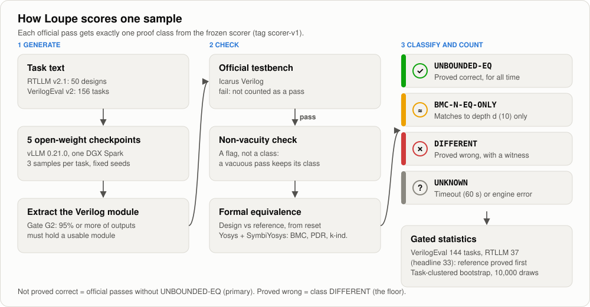
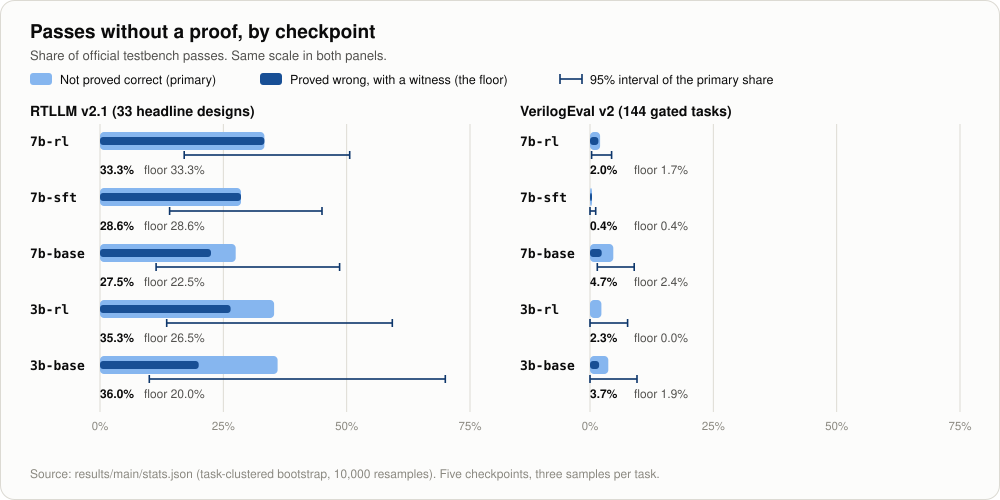
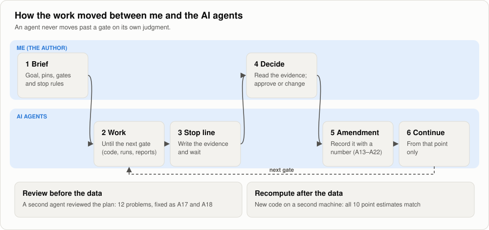
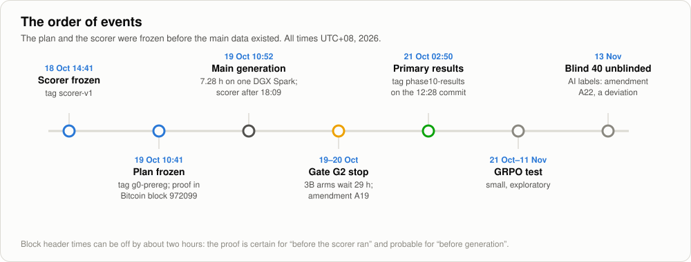

# Loupe

**A closer look at AI-written chip designs that pass their tests.**

[](https://github.com/jishnuvenugopal/loupe/actions/workflows/verify.yml)


<!-- ste:begin -->

## In 30 seconds

- **What:** Loupe checks Verilog that AI models write. It asks one question: when a benchmark test says "pass", does the design have a proof of correctness?
- **How:** For each pass, formal tools compare the design with the reference design, for all inputs, from reset. The tools give a proof or a counterexample.
- **Main result:** On the RTLLM benchmark, 27.5% to 36.0% of the passes from five open-weight models do not have a proof. For 20.0% to 33.3% of the passes, the tools found a witness: an input where the design and the reference disagree.
- **The other benchmark:** On VerilogEval, the tests are much stronger. At most 4.7% of passes do not have a proof.
- **Caveat:** A difference from the reference is not always a bug. An exploratory AI review of 40 such cases found 18 real bugs (45%).
- **Rules:** I froze the analysis plan before the main generation run. A Bitcoin timestamp proves that the plan existed before the scorer ran on any output.

## Explain like I am five

A teacher must mark a page of 100 sums. The teacher checks only five sums. If those five are right, the page gets a gold star. So a page can get a gold star and still have wrong sums.

Chip tests work in a similar way. A chip is a machine of very small switches. Today, people ask AI to write the plans for chips. A benchmark gives the AI a task, and a short test tries some inputs. If the outputs look right, the AI gets a point.

A loupe is the small lens that a jeweller uses to look closely at a stone. This project is a loupe for that point. It uses a math tool that looks at every input, at every clock step. The tool can say "these two designs always do the same thing". Or it can show one exact case where they differ. We call that case a witness, and anybody can replay it.

## Why this matters

- **Scores pick the winners.** People use benchmark scores to decide which AI model is best. If the test is weak, the score is too high.
- **Scores teach the models.** Reinforcement learning uses the test result as a reward. A weak test can teach a model to pass the test, not to build a correct circuit.
- **Chip mistakes are expensive.** You can update software after a release. You cannot update a chip after the factory makes it.

## The vision

AI will write a larger part of hardware design. The scores that train and select those models must be true. Loupe shows one way to make a score true:

1. Give each pass a proof class, not only the word "pass".
2. Freeze the analysis plan before the main data exists.
3. Keep a witness for each failure, so other people can replay it.
4. Put the limits beside the results, not in a footnote.

<!-- ste:end -->

## How it works in one picture

<picture>
  <source media="(prefers-color-scheme: dark)" srcset="docs/img/pipeline-dark.svg">
  
</picture>

The method in detail: [`docs/how-it-works.md`](docs/how-it-works.md).

## What Loupe found

Five open-weight checkpoints, three samples per task. Strict metrics use only the tasks where the reference itself has a full proof: VerilogEval 144 tasks, RTLLM 37 designs, of which the headline uses 33 (four designs with reference problems are reported apart). Shares are of official passes. Intervals are 95% task-clustered bootstrap intervals (10,000 resamples) from the pre-registered analysis.

<picture>
  <source media="(prefers-color-scheme: dark)" srcset="docs/img/results-dark.svg">
  
</picture>

<!-- loupe:headline:begin -->
| Model | Benchmark | Official passes | Official pass@1 % | Strict pass@1 % | Not proved correct % [95% CI] | Proved wrong % [95% CI] |
|---|---|---|---|---|---|---|
| 7b-rl | RTLLM | 81 | 81.8 | 54.5 | **33.3 [17.1, 50.6]** | 33.3 [17.1, 50.6] |
| 7b-sft | RTLLM | 77 | 77.8 | 55.6 | **28.6 [14.1, 45.0]** | 28.6 [14.1, 45.0] |
| 7b-base | RTLLM | 40 | 40.4 | 29.3 | **27.5 [11.4, 48.6]** | 22.5 [7.3, 41.9] |
| 3b-rl | RTLLM | 34 | 34.3 | 22.2 | **35.3 [13.5, 59.3]** | 26.5 [8.3, 48.4] |
| 3b-base | RTLLM | 25 | 25.3 | 16.2 | **36.0 [10.0, 70.0]** | 20.0 [4.0, 42.9] |
| 7b-rl | VerilogEval | 294 | 68.1 | 66.7 | 2.0 [0.3, 4.4] | 1.7 [0.0, 4.0] |
| 7b-sft | VerilogEval | 282 | 65.3 | 65.0 | 0.4 [0.0, 1.2] | 0.4 [0.0, 1.2] |
| 7b-base | VerilogEval | 127 | 29.4 | 28.0 | 4.7 [1.5, 9.0] | 2.4 [0.0, 5.6] |
| 3b-rl | VerilogEval | 130 | 30.1 | 29.4 | 2.3 [0.0, 7.6] | 0.0 [0.0, 0.0] |
| 3b-base | VerilogEval | 54 | 12.5 | 12.0 | 3.7 [0.0, 9.5] | 1.9 [0.0, 6.2] |
<!-- loupe:headline:end -->

| Short name | Checkpoint |
|---|---|
| 7b-base | `Qwen/Qwen2.5-Coder-7B-Instruct` |
| 7b-sft | `zhuyaoyu/CodeV-R1-Distill-Qwen-7B` (supervised fine-tune of 7b-base) |
| 7b-rl | `zhuyaoyu/CodeV-R1-RL-Qwen-7B` (reinforcement learning on top of 7b-sft) |
| 3b-base | `Qwen/Qwen2.5-Coder-3B-Instruct` |
| 3b-rl | `Nellyw888/VeriReason-Qwen2.5-3b-RTLCoder-Verilog-GRPO-reasoning-tb` |

<!-- ste:begin -->

How to read the table:

- **Not proved correct** means that the official test passed, but the formal tools found no full proof that the design matches the reference. This is the primary number.
- **Proved wrong** means that the tools found a witness: an input sequence where the design and the reference give different outputs. This number is the floor of the primary number.
- **Strict pass@1** counts a sample only when it passes the test and has a full proof.
- The result is about the RTLLM tests. The VerilogEval tests catch almost all of these differences.
- For 7b-rl and 7b-sft on RTLLM, every pass without a proof has a witness. Those passes are real differences, not gaps in the tools.

<!-- ste:end -->

### Does reinforcement learning make it worse?

The pre-registered secondary questions compare 7b-rl with its parent 7b-sft, over both benchmarks together.

<!-- loupe:contrasts:begin -->
| Name | Question | Difference (points) | 95% CI | Call |
|---|---|---|---|---|
| H1 | Does 7b-rl have a larger not-proved-correct share than 7b-sft? | +2.4 | [0.1, 5.1] | resolved |
| H1-floor | Same question, with the proved-wrong share | +2.1 | [-0.1, 4.8] | not resolved |
| H2 | Is the lead of 7b-rl on the official score larger than its lead on the strict score? | +1.9 | [0.2, 3.8] | resolved |
<!-- loupe:contrasts:end -->

<!-- ste:begin -->

The lead of 7b-rl over 7b-sft is 1.9 points larger on the official score than on the strict score. So a small part of what reinforcement learning adds on the benchmark does not survive the proof check. The floor version of H1 is not resolved, because its interval includes zero.

### Checks on the checker

- **The official tests are weak on RTLLM.** The scorer made 528 small changes (mutants) to the 50 RTLLM reference designs. The formal tools showed that 438 mutants behave differently. The official tests passed 75 of those 438 (17.1%).
- **The scorer agrees with the benchmark authors.** It reproduces the test verdicts in the RTLLM paper for 290 of 290 GPT outputs that RTLLM ships.
- **Two simulators agree.** Icarus and Verilator give the same pass or fail verdict on every row that both ran.
- **The generation matches published scores.** The official pass@1 of the three 7B models on all 156 VerilogEval tasks puts each published score inside its 95% interval.
- **Two RTLLM reference designs have bugs.** Loupe reported `accu` ([RTLLM #25](https://github.com/hkust-zhiyao/RTLLM/issues/25)) and `LIFObuffer` ([RTLLM #26](https://github.com/hkust-zhiyao/RTLLM/issues/26)) upstream. Two more designs, `RAM` and `square_wave`, match open upstream reports ([#16](https://github.com/hkust-zhiyao/RTLLM/issues/16), [#23](https://github.com/hkust-zhiyao/RTLLM/issues/23)). The headline leaves out all four designs.

<!-- ste:end -->

## Exploratory AI adjudication — protocol deviation

> The planned single-author human adjudication was replaced, with operator approval on 12 Nov 2026 after AI labelling was completed, by one AI-generated review. No independent human rater assessed these 40 packets. The reviewer did not access the hidden arm key but had prior aggregate study context. The five unclear labels were retained. These exploratory labels do not change the pre-registered primary results.

The heading and the quote above keep the exact wording that study amendment A22 requires. The sample: 40 of the 75 unique passes that have a witness, drawn at random and stratified by model and benchmark, with the model names hidden. Labels come from one AI review session. Shares describe this sample of 40 only, with Wilson 95% intervals.

<!-- loupe:blind40:begin -->
| Label | Count | Share % [95% CI] |
|---|---|---|
| real bug | 18 | 45.0 [30.7, 60.2] |
| reference wrong | 5 | 12.5 [5.5, 26.1] |
| allowed by spec | 12 | 30.0 [18.1, 45.4] |
| unclear | 5 | 12.5 [5.5, 26.1] |
| scorer artefact | 0 | 0.0 [0.0, 8.8] |
<!-- loupe:blind40:end -->

<!-- ste:begin -->

What this sample suggests: a witness shows a real difference from the reference, but the difference is not always a bug. About half of the cases were real bugs. Many others were behaviour that the written task allows, because the task text is not precise. In 5 cases, the review judged the reference itself to be wrong. The review found no case where the scorer made the difference up.

## A small training test (exploratory)

After the main study, I ran a small reinforcement learning test. The question: does a reward with a proof check teach better than a reward from the test alone?

- **Model:** `Qwen/Qwen2.5-Coder-1.5B-Instruct` with a LoRA adapter (rank 16), GRPO in TRL 1.15.0 with vLLM, on one DGX Spark.
- **Data:** 1,149 tasks from the VeriReason RTL dataset, with 64 held out. The model writes 8 answers per prompt.
- **Rewards:** W uses the test verdict only. S adds a non-vacuity check and a formal check with a 10-second limit.
- **Settings:** brief (100 steps, learning rate 1e-6) and extended (300 steps, learning rate 1e-5).

<!-- ste:end -->

<!-- loupe:e1:begin -->
| Contrast | Benchmark | Official pass@1 difference [95% CI] | Not-proved-correct difference [95% CI] |
|---|---|---|---|
| wext_minus_base (W reward, extended − untrained) | VerilogEval | +5.5 [1.6, 9.7] | +4.8 [-2.4, 13.3] |
| wext_minus_base (W reward, extended − untrained) | RTLLM | +9.1 [1.0, 19.2] | -5.9 [-33.1, 17.5] |
| sext_minus_base (S reward, extended − untrained) | VerilogEval | +7.6 [3.2, 12.3] | +1.7 [-4.5, 8.6] |
| sext_minus_base (S reward, extended − untrained) | RTLLM | +12.2 [1.0, 24.2] | -5.3 [-35.9, 23.0] |
| sext_minus_wext (S − W, both extended) | VerilogEval | +2.1 [-1.2, 5.3] | -3.1 [-7.6, 0.0] |
| sext_minus_wext (S − W, both extended) | RTLLM | +3.1 [-4.0, 12.1] | +0.6 [-24.4, 25.6] |
<!-- loupe:e1:end -->

<!-- ste:begin -->

What this shows, and what it does not show:

- Extended training raised the official score with both rewards. All four of those intervals exclude zero.
- No change in the not-proved-correct share has an interval that excludes zero.
- At this size, the S reward did not measurably beat the W reward.
- Eight of the ten generation files are below the 0.95 extraction gate. Read these numbers as a pilot, not as a result.

All five arms, all contrasts and the brief settings are in [`results/e1/summary.md`](results/e1/summary.md).

## The gaps

### Gaps in the benchmarks

- The RTLLM tests miss many differences from the reference. VerilogEval has much stronger tests.
- Two RTLLM reference designs have bugs, and two more have open upstream reports.
- Some task texts allow more than one behaviour. In the AI review, 12 of 40 cases were behaviour that the task allows.

### Gaps in this study

- **Reference, not intent.** The proof compares a design with the reference design. A design can differ from the reference and still meet the task text.
- **Reset assumption.** Both designs start with all flip-flops at zero, and the comparison starts after a common reset.
- **Small sets.** Only 33 RTLLM designs pass the gate, so the RTLLM intervals are wide.
- **Selection.** Designs that the formal tools cannot read or prove stay out of the gate. The result speaks only for designs that the tools can check.
- **Scope.** Five checkpoints, two model families, three samples per task, one machine.
- **Extraction.** Two 3B files were slightly below the 0.95 extraction gate. Two pinned waivers record this, and a sensitivity run with longer outputs gave the same conclusions.
- **Labels.** One AI session labelled the 40 blind cases. No human rater checked them.
- **Training test.** The GRPO runs are small, short and exploratory.

### Gaps in my own knowledge

I am an AI engineer, not an RTL engineer. I did not judge any design from my own experience. Every RTL claim here rests on tool output, on a witness that you can replay, or on a published anchor. If you find a mistake, please open an issue.

## Who did what

<!-- ste:end -->

| Part | Me (the author) | AI agents | Tools |
|---|---|---|---|
| Question and rules | Chose the question, the two definitions of correct, the gates and the stop rules | Proposed options and found defects in early drafts | — |
| Analysis plan | Approved every gate and every amendment (A13 to A22) | Wrote the plan text and the frozen analysis code | OpenTimestamps |
| Code and runs | Fixed the machine set-up; decided each stop | Wrote the scorer, the pipeline and the reports; ran the jobs on the DGX Spark | vLLM, Yosys, SymbiYosys, Icarus, Verilator, TRL |
| Review | Read the reviews and chose the fixes | One agent reviewed another agent's plan before the main run; a second machine recomputed every headline number | — |
| Blind labels | Approved the switch from human to AI labels, and recorded it | One AI session labelled the 40 cases | — |
| Write-up | Approved every claim and every limit | Drafted this text | `verify/check.py`, `verify/ste_lint.py` |

<!-- ste:begin -->

## How the AI workflow stayed honest

This project also tests a method. Can AI agents run a careful study in a field that the author does not know well? These rules made it possible.

1. Freeze the analysis plan and timestamp it before the main run starts.
2. Hash the scorer, and check the hash before each run of the scorer.
3. Give each step a gate with a written stop line.
4. Let one agent review another agent's plan before the main run.
5. Recompute the headline numbers on a second machine, with new code.
6. Write down every amendment, also the ones that weaken the study.
7. Keep the failures in the log: three restarts, a file race, and a network outage.

<picture>
  <source media="(prefers-color-scheme: dark)" srcset="docs/img/agent-loop-dark.svg">
  
</picture>

The full story is in [`docs/ai-workflow.md`](docs/ai-workflow.md).

## Check it yourself

- **The numbers:** `verify/check.py` recomputes the headline table from the per-sample scores with independent code. Then it compares every number in the tables above with the data files. CI runs it on each push.
- **The date of the plan:** Bitcoin block 972099 holds the OpenTimestamps proof of `PREREG.md`. The header time of that block is 10:49 (UTC+08) on 19 Oct 2026. The main generation run started at 10:52, and the scorer started after 18:09. Block header times can be wrong by up to about two hours. So the proof is certain for "before the scorer ran", and probable for "before generation".
- **The witnesses:** Each proved-wrong pass has a trace in [`results/main/cex/`](results/main/cex/).
- **The upstream reports:** RTLLM issues #25 and #26 are open. On 15 Nov 2026 they had no reply.

<picture>
  <source media="(prefers-color-scheme: dark)" srcset="docs/img/timeline-dark.svg">
  
</picture>

<!-- ste:end -->

```bash
git clone https://github.com/jishnuvenugopal/loupe.git && cd loupe
python3 -m pip install numpy
python3 verify/check.py        # recompute + compare README tables with the data
python3 verify/ste_lint.py README.md
```

To check the timestamp, give `PREREG.md` and `PREREG.md.ots` to the [OpenTimestamps](https://opentimestamps.org) verifier, or run `ots verify PREREG.md.ots` with the OpenTimestamps client.

## Repository map

| Where | What |
|---|---|
| `main` (this branch) | This README, `docs/`, `verify/`, CI, licences. The five-arm E1 report regenerated with the pinned script |
| `spark` branch | The frozen run record from the DGX Spark, commit by commit |
| Tags `scorer-v1`, `g0-prereg`, `phase10-results` | Scorer freeze, plan freeze, primary results |
| `PREREG*.md` + `.ots` | The analysis plan and its amendments, each with a timestamp proof. The committed A21 proof still holds only calendar attestations (`ots upgrade` completes it). A22 has no stamp, by design |
| `scorer/`, `deep/` | The strict scorer (frozen at `scorer-v1`) |
| `scoring/` | Extraction, gates, statistics, dedup, contamination, blind sample |
| `gen/`, `prompts/`, `models/` | Generation, prompts, pinned model revisions and cards (no weights) |
| `scores/`, `results/` | Per-sample scores, tables, witnesses |
| `grpo/`, `e1/` | The small training test and its evaluation |
| `notes/` | The raw run log and receipts (see [`docs/lab-notebook.md`](docs/lab-notebook.md)) |
| [`docs/how-it-works.md`](docs/how-it-works.md) | The method in detail, for RTL and evaluation readers |
| [`docs/credits.md`](docs/credits.md) | Credits, upstream reports and related work |
| `docs/img/` | The figures and the script that draws them (`make_figures.py`) |

## Credits

<!-- ste:begin -->

Loupe uses two public benchmarks, open-weight models from three teams, and open-source EDA and machine learning tools. Other people reported RTLLM problems before me. Two designs that the headline leaves out match their open reports. [`docs/credits.md`](docs/credits.md) names all of this work, with links. It also lists related work that I checked before the analysis plan froze.

<!-- ste:end -->

## Licences and citation

My own code and text: [Apache-2.0](LICENSE). Benchmarks, model cards and model outputs keep their own licences: see [`THIRD_PARTY.md`](THIRD_PARTY.md). No model weights are in this repository. To cite Loupe, use [`CITATION.cff`](CITATION.cff).

<!-- ste:begin -->

## Glossary of technical names

benchmark, testbench, Verilog, RTL, checkpoint, reference design, formal equivalence, witness, counterexample, flip-flop, reset, pass@1, bootstrap, reinforcement learning, GRPO, LoRA, pre-registration, OpenTimestamps, extraction gate

<!-- ste:end -->

| Name | Meaning |
|---|---|
| Verilog, RTL | A language for chip designs; RTL is the level of detail it describes |
| Benchmark | A fixed set of tasks with a way to score the answers |
| Testbench | A small program that tries some inputs on a design and checks the outputs |
| Reference design | The benchmark's own answer for a task |
| Formal equivalence | A math check that two designs give the same outputs for all inputs |
| Witness / counterexample | One exact input sequence where two designs differ |
| Flip-flop, reset | A one-bit memory cell; the signal that puts a design in its start state |
| pass@1 | The chance that one sample passes |
| Bootstrap | A way to estimate an interval by resampling the tasks many times |
| Reinforcement learning, GRPO | Training a model from rewards; GRPO is one such method |
| LoRA | A small adapter that trains a few extra weights instead of the whole model |
| Pre-registration | Writing the analysis plan before the data exists |
| OpenTimestamps | A free service that proves a file existed at a time, with Bitcoin |
| Extraction gate | The rule that at least 95% of outputs must contain a usable Verilog module |
