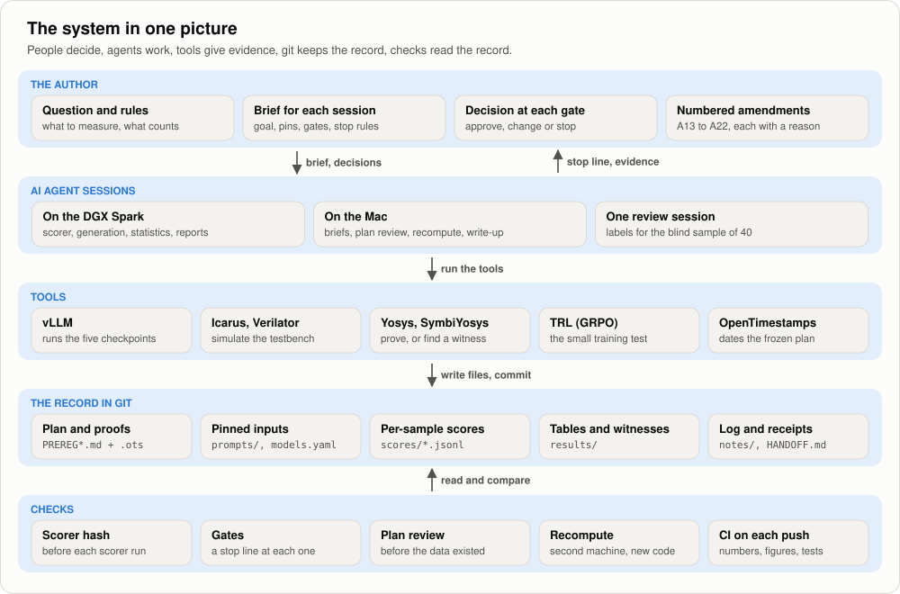

# The architecture

<picture>
  <source media="(prefers-color-scheme: dark)" srcset="img/architecture-dark.svg">
  
</picture>

<!-- ste:begin -->

This page shows the system behind Loupe: who does what, with which tools, and what checks the work. The method of the study is in [`how-it-works.md`](how-it-works.md). The story of the agent work is in [`ai-workflow.md`](ai-workflow.md).

## The five layers

| Layer | What it holds | Where in this repository |
|---|---|---|
| The author | The question, the rules, the decision at each gate | `PREREG.md` and its amendments |
| AI agent sessions | Code, runs and reports, on a DGX Spark and on a Mac | `notes/LOG.md`, `HANDOFF.md` |
| Tools | vLLM, Icarus, Verilator, Yosys, SymbiYosys, TRL, OpenTimestamps | `requirements.lock`, `models/pull_images.sh` |
| The record | The frozen plan, pinned inputs, scores, results, witnesses, receipts | `PREREG*.md`, `prompts/`, `models.yaml`, `scores/`, `results/`, `notes/` |
| The checks | Scorer hash, gates, plan review, recompute, CI | `scoring/run_scoring.py`, `verify/`, `.github/workflows/verify.yml` |

## The flow of one change

1. The author writes a brief with the goal, the pins and the gates.
2. An agent session works until a gate, writes a stop line and waits.
3. The session commits its code, results and reports to the run branch.
4. The author reads the evidence and decides.
5. The session records the decision as a numbered amendment and continues.

## The checks

- The scorer stays frozen at tag `scorer-v1`. A hash check runs before each scorer run. Each score row names the scorer commit and the scorer hash.
- The analysis plan froze before the main generation run. A Bitcoin timestamp proves the order. See `PREREG.md.ots`.
- A second machine recomputed every headline number with new code. That code is `verify/recompute.py`, and CI runs it on each push.
- CI also compares every README table number with the data files, lints the prose, checks the figures and runs the tests.
- The figures on these pages come from `img/make_figures.py`. The data figures read the data files, and CI fails on a stale figure.

<!-- ste:end -->
