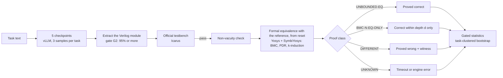
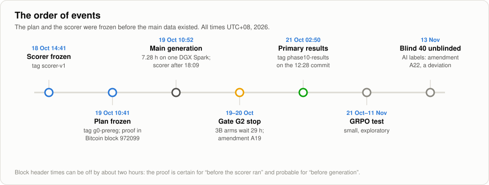

# How Loupe works

This page is for readers who know evaluation or RTL. The [README](../README.md) has the short version. The authority for every rule here is the analysis plan, [`PREREG.md`](../PREREG.md), and its amendments.

## The pipeline



<!-- ste:begin -->

## Proof classes

Each official pass gets exactly one proof class from the frozen scorer.

| Class | Meaning |
|---|---|
| `UNBOUNDED-EQ` | PDR or SMT k-induction proves that the design matches the reference for all time, from reset |
| `BMC-N-EQ-ONLY` | The designs match up to depth d (10 cycles by default), but no unbounded proof exists |
| `DIFFERENT` | A witness exists: an input sequence where the outputs differ |
| `UNKNOWN` | Timeout (60 s) or an engine error, or a port or read failure |

Vacuity is a flag, not a class. A vacuous pass keeps its proof class.

The three reported shares nest. The proved-wrong share is always the smallest. The not-proved-correct share is always the largest:

- **Not proved correct** = official passes without `UNBOUNDED-EQ`, as a share of official passes. This is the primary outcome.
- **Not correct within depth d** = official passes without `UNBOUNDED-EQ` or `BMC-N-EQ-ONLY`.
- **Proved wrong** = official passes with class `DIFFERENT`. This is the floor.

## The reset scaffold

A wrapper gives both designs the same start. The rules:

1. Apply a common reset for two cycles, with the enables held high.
2. Start the comparison at cycle three.
3. Start every flip-flop at zero in both copies.
4. Map memories, and resolve tri-state signals.

Without rule 3, seven reference designs failed the self-equivalence check for no real reason. So the rule is necessary, but it is also an assumption. Zero start values can hide a difference that other start values would show. A proof here holds for this start state only.

## The gates

Strict metrics use only tasks where the reference itself is solid. A reference must have an unbounded self-equivalence proof, pass its own testbench in Icarus, and read cleanly in Yosys.

- **VerilogEval v2 (156 tasks):** 144 tasks pass the gate. Six tasks have Yosys read errors, one official testbench does not compile, and five references have bounded proofs only.
- **RTLLM v2.1 (50 designs):** 40 designs are usable, and 37 of them pass the gate. Three references have bounded proofs only.
- **Headline RTLLM set (33 designs):** the 37 minus four designs with reference problems. Those four are `accu`, `LIFObuffer`, `RAM` and `square_wave`, and `results/main/apart.json` reports them apart.

The gate lists are in [`scoring/gates/`](../scoring/gates/).

## Sampling

Each checkpoint runs at the protocol that its authors published.

| Checkpoint family | Temperature | top_p | Max new tokens |
|---|---|---|---|
| CodeV-R1 7B: base, Distill, RL | 1.0, 0.6, 1.0 | 1.0 on VerilogEval, 0.95 on RTLLM | 16,384 |
| VeriReason 3B: base, GRPO | 0.2 | 0.95 | 2,048 |

All arms use three samples per task, a fixed seed per task, and vLLM 0.21.0 in one pinned container on one DGX Spark. The full settings, the pinned model revisions and the weight hashes are in `PREREG.md` and [`models.yaml`](../models.yaml).

## Statistics

- Shares use official passes as the denominator.
- Intervals come from a task-clustered bootstrap with 10,000 resamples and seed 0.
- Paired contrasts use the same task draws for both arms.
- A contrast is "resolved" only when its 95% interval excludes zero.

## Checks on the checker

- **Anchor:** the scorer reproduces 290 of 290 testbench verdicts that the RTLLM paper reports for the GPT outputs that RTLLM ships.
- **Two simulators:** on every row that both simulators could run, Icarus and Verilator give the same pass or fail verdict.
- **Power:** of 528 seeded mutants of the RTLLM references, the formal tools show 438 to behave differently. The official testbenches accept 75 of those (17.1%). The strict scorer rejects all 438, but that number shows nothing on its own. The same engines define "different", so it is true by construction.
- **Fidelity (gate G1b):** official pass@1 on all 156 VerilogEval tasks puts the published score of each 7B checkpoint inside its 95% interval.

The details are in [`DEEP_REPORT.md`](../DEEP_REPORT.md).

## Sensitivity rows

The plan fixed the first four views before the main run. Amendment A19 added the fifth. None of them is a headline.

- All 37 RTLLM designs: `results/main/stats_all37.json`
- The wide gate (149 and 40 tasks), companion metric only: `results/main/stats_wide.json`
- One row per unique design after dedup: `results/main/stats_dedup.json`
- Tasks with possible contamination left out: `results/main/stats_drop.json`
- Longer outputs for the two 3B arms: `results/sens/summary.md`

## Timeline

<picture>
  <source media="(prefers-color-scheme: dark)" srcset="img/timeline-dark.svg">
  
</picture>

| Date (UTC+08) | Event |
|---|---|
| 18 Oct 2026, 14:41 | Scorer frozen: tag `scorer-v1` |
| 19 Oct, 10:41 | Analysis plan frozen and stamped: tag `g0-prereg`. Bitcoin block 972099 (header time 10:49) holds the proof |
| 19 Oct, 10:52 to 18:09 | Main generation run (7.28 h) |
| 19 Oct to 20 Oct | Gate G2 stops the 3B arms; amendment A19 records the fix after 29 h |
| 21 Oct, 02:50 | Primary results complete; the close-out commit at 12:28 carries tag `phase10-results` |
| 21 Oct to 11 Nov | GRPO runs and their evaluation (exploratory) |
| 13 Nov | Blind sample of 40 unblinded with AI labels (amendment A22) |

## Known code notes

These notes have no effect on the published numbers.

- `scoring/stats.py::_boot_draw` counts proved-wrong verdicts over all rows of a task, not only over official passes. In this data every `DIFFERENT` verdict sits on an official pass, so the floor intervals do not change.
- The H1 and H2 "mean" in `stats.json` is the bootstrap mean. It agrees with the point estimate to 0.01 points here.
- The usage text at the top of `scoring/blind40.py` shows an `--out` flag that the code does not define.

## Rerun the scorer

The scorer expects pinned tool and benchmark folders. To rerun it on one sample:

1. Install `oss-cad-suite` 2026-10-16 into `~/eda/oss-cad-suite`.
2. Clone RTLLM at `51ed553` into `~/bench/RTLLM`.
3. Clone VerilogEval at `c498220` into `~/bench/verilog-eval`.
4. Run the command below.

<!-- ste:end -->

```bash
python3 scorer/score.py --bench rtllm --task <design> --sample <file.v> --out <dir>
```
